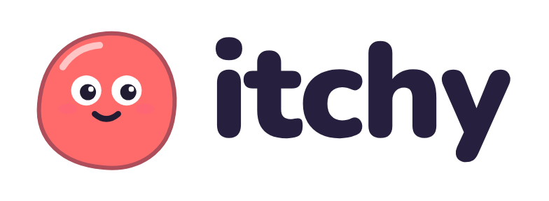
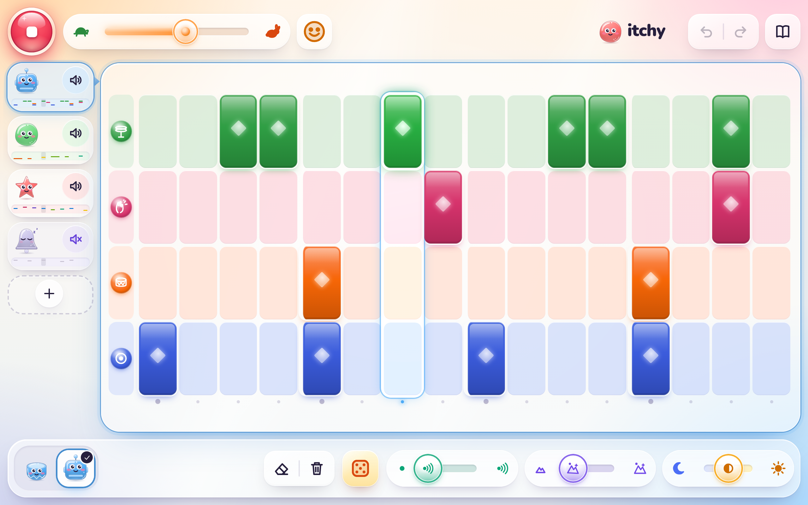
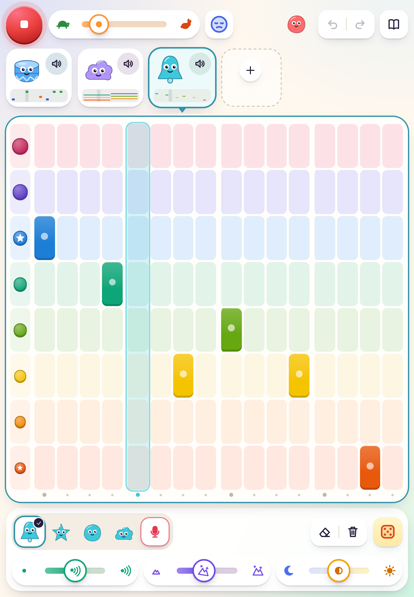
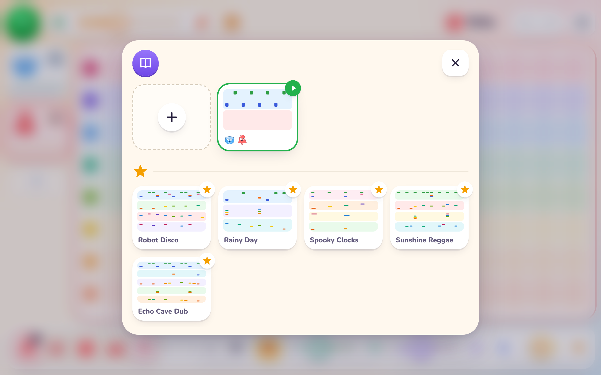
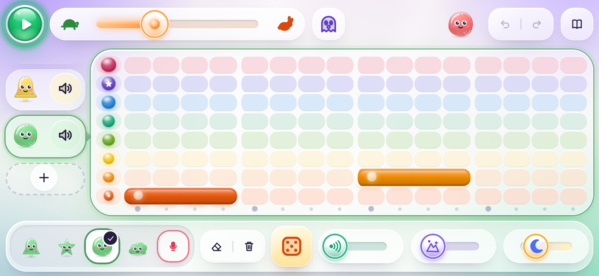

<p align="center">
  <a href="https://hcaw.github.io/itchy/">
    <picture>
      <source media="(prefers-color-scheme: dark)" srcset="docs/images/logo-dark.png">
      
    </picture>
  </a>
</p>

<p align="center">
  <strong>A music-making toy for children aged 6–11, in the browser.</strong><br>
  Tap the grid and a critter sings. No reading, no sign-up, no tracking.
</p>

<p align="center">
  <a href="https://hcaw.github.io/itchy/"><strong>▶&nbsp;Play Itchy now</strong></a>
  &nbsp;·&nbsp;
  <a href="#run-it-yourself">Run it yourself</a>
  &nbsp;·&nbsp;
  <a href="CONTRIBUTING.md">Contribute</a>
</p>

<p align="center">
  <a href="https://github.com/hcaw/itchy/actions/workflows/ci.yml"></a>
  <a href="https://github.com/hcaw/itchy/actions/workflows/pages.yml"></a>
  <a href="LICENSE"></a>
  
</p>

<p align="center">
  
</p>

## What is it?

Press play and your loop goes round. Add critters, give them charms, roll the dice, record your own voice. Itchy is
a toy before it's a tool: a child makes a sound in the first few seconds and works out the rest by playing. There's
no tutorial, and no adult needed.

It follows the idea behind Scratch: **low floor, high ceiling, wide walls**. A first beat takes seconds, but a
curious child who keeps coming back can make music that is complex and genuinely their own: melodies, drum
patterns, polyrhythms, spooky soundscapes and songs built from their own claps and voice.

- **Made for small hands.** Big targets, touch, mouse or keyboard, on tablets, Chromebooks and laptops.
- **Sounds good by default.** Every note is in tune with the mood, so random poking makes music.
- **Nothing can go wrong.** Undo is always one tap away, and work saves itself.
- **Private by design.** Songs and recordings stay on the device. No accounts, adverts, analytics or tracking.
- **Light and open.** Nothing to install, no build step, and Itchy's own code is MIT licensed (the openDAW engine it
  plays on is AGPL; see [Licence](#licence)). Every sound and picture is made in code.

The goal, audience, design principles and constraints are in [`docs/BRIEF.md`](docs/BRIEF.md). How Itchy meets them,
and every design decision, is in [`docs/CONCEPT.md`](docs/CONCEPT.md).

<table>
  <tr>
    <td width="50%"></td>
    <td width="50%">
      
      <br><br>
      
    </td>
  </tr>
  <tr>
    <td align="center"><sub>Tablets: the critters move to the top</sub></td>
    <td align="center"><sub>The songbook, and a phone on its side</sub></td>
  </tr>
</table>

## How it plays

| You see | You do | You hear |
| --- | --- | --- |
| Big green ▶ | tap it (or press Space) | the loop goes round; the playhead lights up each column |
| The grid | tap or drag to paint notes, tap again to rub out | each note as you place it |
| Critters on the left | tap one to edit it; tap its speaker to send it to sleep | its voice; sleeping critters close their eyes |
| **+** | pick a new critter (drums, bells, pluck, bass, cloud or 🎤) | its first note |
| Sounds under the grid | choose what the critter sounds like, or press the red mic to record | a preview |
| Dice | a new pattern for this critter | the first bar of it |
| Charms: Echo, Space, moon↔sun | drag the big handle | the effect, live |
| Face | choose a mood (scale) for every tune critter | an arpeggio in that mood |
| Turtle ↔ rabbit | drag to change speed | a tick at the new speed |
| ↶ ↷ | undo or redo anything | a whoosh |
| Book | every song you've made, plus three examples | — |
| The Itchy critter (top bar) | tap it | a little hello in the current mood (it changes colour each time) |

Keyboard: Space plays and stops, arrow keys move around the grid, Enter places a note, Ctrl/⌘+Z undoes, Ctrl/⌘+Y
redoes, and keys 1–6 pick a critter.

## Run it yourself

```sh
git clone https://github.com/hcaw/itchy.git
cd itchy
npm start
```

Then open <http://localhost:5173/>. You need Node 18 or newer. There is nothing to install: Itchy has no
dependencies to install and no build step. `npm start` sends the cross-origin isolation headers that openDAW's
engine needs; any other static file server works too, for example `python3 -m http.server`, but without those
headers Itchy plays on its built-in engine. Opening
`index.html` straight from disk won't work, because browsers block ES modules on `file://`.

To put it on your own site, copy what `node scripts/collect-site.mjs <folder>` collects (`index.html`,
`manifest.webmanifest`, `styles.css`, `coi-serviceworker.js`, `src/`, `assets/` and `vendor/`) to any static host.
The [Pages workflow](.github/workflows/pages.yml) does exactly this for <https://hcaw.github.io/itchy/> on every
push to `main`.

Every pull request also gets its own preview on Vercel, so you can try a change before it's merged: Vercel's bot
posts the link on the pull request. Each preview has its own web address, so songs saved there never touch the ones
on the live site. [`vercel.json`](vercel.json) turns off Vercel deploys from `main`, and
[`.vercelignore`](.vercelignore) uploads only the app's files.

Checks:

```sh
npm test             # unit tests: scheduler timing, data model, undo, storage, dice, recording clean-up, the openDAW
                     # mirror and edits, the vendored files, what the site ships, docs pictures
npm run check        # browser checks in headless Chromium (needs Playwright); screenshots go to test-output/
npm run screenshots  # re-render the logo, icons and README screenshots from the app (see "Screenshots" below)
```

## Engine and browsers

Itchy has two sound engines, and a child never has to know. Every page starts on Itchy's own Web Audio engine, so the
first tap always sounds. Where the browser can run it, [openDAW](https://github.com/andremichelle/openDAW)'s engine
loads in the background and takes over as soon as it is ready and the music is stopped.

| Where | What plays |
| --- | --- |
| Safari and iPadOS 17.4+, Chrome and Edge 119+, Firefox 121+, on a cross-origin isolated page | openDAW, once it has loaded |
| Older browsers (for example an iPad below iPadOS 17.4), service workers turned off, a page shown inside another site, or a plain static server without the isolation headers | the built-in engine, with no reload and nothing fetched from `vendor/` |
| Any page with `?engine=native` on the end of its address | the built-in engine (handy for comparing the two) |
| A tab where openDAW stopped working, or whose last openDAW start crashed | the built-in engine, at once and for the rest of the visit |

openDAW needs a **cross-origin isolated** page. `npm start` and Vercel send the two headers that make one. GitHub
Pages can't, so there [`coi-serviceworker.js`](coi-serviceworker.js) adds them: a capable browser reloads the page
**once or twice on its first visit** and never again. Browsers that could never run openDAW are not reloaded. In
the browser's console, `crossOriginIsolated` says whether the page is isolated, `itchy.engine.kind` says which engine
is playing (`'opendaw'` or `'native'`), and `itchy.engine.readyAt` says how many milliseconds after the page started
loading the engine settled.

What we measured, in headless Chromium in a container (`npm run check` holds each of these to a budget):

- **First visit on a slow network** (DevTools' Fast 3G with a 4× slower CPU, served over HTTP/2 with gzip as GitHub
  Pages and Vercel serve it): the app appears in about 2.2 s and the first tap is heard in about 2.4 s, on the
  built-in engine. openDAW is ready after about 20 s. It is 5.1 MB, of which 2.6 MB goes over the network. On the next
  visit nothing is downloaded again and openDAW is ready in about 2.3 s.
- **Reloads to become isolated without the headers**, as on GitHub Pages: 2 page loads in all 20 first visits in
  Chromium; in WebKit, 2 in 114 and 3 in 6 of 120.
- **From touch to sound** (the middle of 5 tries): a grid tap 12.7 ms on openDAW (17.3 ms on the built-in engine),
  changing a sound 10.1 ms (25.9 ms), and a finger in the sounds tray 1.4 ms (17.3 ms).
- **Timing:** tempo within 0.5% at 100 and 140 BPM, and every step of a rendered loop within 1 sample of the grid,
  straight or swung.
- **Loudness:** every sound within 3 dB of the built-in engine. Bells and pluck on the top row are the furthest
  away, about 2 dB quieter, because playing a sample higher also makes it shorter.

These are container numbers; a real iPad is checked by hand before the port is merged.

## Architecture

```
index.html, styles.css      styles.css starts with the design tokens (colours, radii, shadows, motion); index.html
                            also holds the capability probe and the coi-serviceworker setup
coi-serviceworker.js        makes the page cross-origin isolated on GitHub Pages (vendored, MIT)
assets/fonts/               Nunito (SIL Open Font License), bundled so it looks the same on every machine
src/main.js                 boot: open storage → load the last song → start the app
src/audio/
  engine.js                 the facade the app talks to: AudioContext, unlock on first touch, output and level meter,
                            visual event queue, interface blips; picks the backend (openDAW or built-in) and falls
                            back to the built-in one if openDAW fails
  probe.js                  can this browser run openDAW? (AudioWorklet, WebAssembly SIMD, isolation)
  mirror.js                 pure: the project JSON → a description of the openDAW project, and the edits between two
  playhead.js               pure: openDAW's transport position → the steps the screen shows
  render-sounds.js          renders every built-in sound to PCM (seeded, the same on every boot) for openDAW to play
  opendaw/                  the openDAW backend, loaded with import() only where it can run:
    boot.js, engine.js      boot openDAW on Itchy's context; sync, play, stop, previews, recordings, offline renders
    apply.js                the only file that touches openDAW's boxes: applies the mirror's edits in one transaction
    samples.js              Itchy's PCM held in memory for openDAW (nothing written to disk)
  native/engine.js          the built-in engine: per-critter chains, reverb bus, limiter, the scheduler's notes
  scheduler.js              pure lookahead scheduler (no Web Audio inside it, so it can be tested on a fake clock)
  ticker.js                 Web Worker timer that only wakes the scheduler
  instruments.js            every sound, made in code (two drum kits, bells, pluck, bass, cloud, sample playback, reverb impulse)
  recorder.js + capture-worklet.js   mic capture with an AudioWorklet; trim, normalise, fade
vendor/opendaw/<version>/   the openDAW engine (AGPL-3.0), prebuilt by scripts/vendor-opendaw.mjs; never edited by hand
src/model/                  plain data, no DOM or audio
  project.js                the JSON project format, migrate() (repairs anything), helpers
  scales.js, sounds.js      moods and the sound catalogue
  history.js                snapshot undo/redo with gesture grouping
  surprise.js               the dice's pattern generator
  examples.js               example songs
src/storage/storage.js      async storage interface: IndexedDB, else localStorage, else memory
src/ui/                     hand-written DOM, no framework
  store.js                  current project + undo + autosave; every edit goes through store.change()
  app.js                    layout, animation loop (visuals fire when the audio is heard), keyboard
  topbar.js, rail.js, grid.js, panel.js     the four screen regions
  plugins.js                features that plug into the regions: charms.js, experiments.js (mood, dice), mic.js, songbook.js,
                            delight.js (blinking, eyes that follow you, the mood-tinted room, the Itchy hello)
  critters.js, icons.js, widgets.js         original SVG art and small UI helpers
scripts/serve.js            the tiny static server behind npm start (sends the cross-origin isolation headers)
scripts/collect-site.mjs    copies exactly the files the site ships (for GitHub Pages and the checks)
scripts/vendor-opendaw.mjs  rebuilds vendor/opendaw/ from pinned packages (npm run vendor:opendaw)
scripts/screenshots.mjs     renders the logo, icons, social card and README screenshots from the real app
tests/                      unit tests (node --test) and tests/e2e/check.mjs (Playwright)
docs/                       the brief, the concept and decisions log, and the README's pictures (docs/images/)
```

**Sound engines.** On a page that can run it (cross-origin isolated, with AudioWorklet and WebAssembly SIMD: Safari
and iPadOS 17.4+, Chrome 119+, Firefox 121+), [openDAW](https://github.com/andremichelle/openDAW)'s engine plays
the song and every preview. Itchy's sounds are still made in code: at start-up each one is rendered to a sample,
which openDAW's samplers play. After every change the song's JSON is described again (`mirror.js`) and only the
difference is written into openDAW's project. Everywhere else, and for the first moments while openDAW loads,
Itchy's own Web Audio engine plays, so the first tap always sounds; if openDAW ever fails, the built-in engine takes
over at once.

**Timing.** On openDAW the song is sequenced on the audio thread, sample-exact, and tempo and swing are part of its
project. A tap or a preview is played at the next audio block (about 2 to 11 ms from the touch). The few sounds
timed into the future (the hello, the mood arpeggio, the dice preview) go to the built-in engine, which schedules
them exactly on the audio clock. The built-in engine keeps time like this: a worker ticks about every 25 ms; on each
tick the scheduler queues every 16th-note step that falls in the next 120 ms, at exact times on the audio clock.
Tempo is read on every step, so a change lands on the next step without drift. Swing only moves the off-beats. If
the tab freezes, the scheduler skips ahead instead of firing a burst of stale notes. Either way, the UI draws each
step when its sound reaches the speakers, allowing for the output latency (on openDAW, from its transport position,
read every frame and moved on to the current audio time).

**Data.** A song is plain JSON: tempo, swing, mood and key, plus a list of layers. Each layer has a sound, a colour, a
loop length, mute, volume, octave, effects, and notes `{s, r, len, vel}`. Recordings are raw PCM, stored separately by
id. Storage hides behind one async interface (`listProjects`, `loadProject`, `saveProject`, `saveRecording`, …), so
cloud saving can come later as one more class with the same methods. `migrate()` turns any input into a valid song,
which is also the hook for future format versions.

**Undo.** Every change records a snapshot of the song before it. A drag (a paint stroke or a slider) counts as one
step. Opening a different song starts a fresh history, but the old song stays in the songbook.

## Raising the ceiling: next steps

The model and engine already support most of these. What's missing is the gesture to reach them.

1. **Stretchy loops: per-critter loop length.** Drag the grid's right edge to make a loop 3–32 steps long. The engine
   and model already handle different lengths, and the *Spooky Clocks* example uses them. This is the cheapest big
   step up: polyrhythm and phasing come from one gesture.
2. **Stretchy notes and accents.** Drag a note sideways to hold it, and press and hold to make it louder or softer.
   `len` and `vel` are already in the data and played by the engine. This makes bass lines, pads and real melodies
   possible.
3. **Song sections.** Let a song hold several "scenes" (snapshots of which critters are awake and which pattern each
   plays), chained into a song strip. This fits the critter model (a scene is just more data per layer) and is the
   route to whole songs and to live performance.
4. **Voice kits.** Let a recording go onto one drum row, so a child can build a kit from their own claps and mouth
   noises. Add simple trimming by dragging the ends of the waveform.
5. **Charms as objects.** Make charms things you drag onto a critter, add more (wobble, bitcrush, reverse), and let a
   critter wear several in an order you can see.
6. **Chance and rules.** Give notes a probability, and add "dice with a lock" (keep the rhythm, reroll the pitches).
   Allow more moods and a choice of key. These make generative music possible without new modes.
7. **Export and share.** Render a song to WAV with `itchy.engine.renderOffline()`, which already renders any song on
   openDAW, sample-exact (the checks use it), so export only needs a gesture and a file. Share
   a song as a JSON file or link (recordings travel as compressed audio). Add a `CloudStorage` class for accounts.
8. **A tidy songbook.** Names drawn as pictures, a bin with undo, and duplicating a song.

Items 1 and 2 come first because they unlock the most musical depth for the least new interface. Item 3 is next
because it turns loops into songs.

## Known rough edges

- Only one critter's grid is visible at a time. The others show as mini-maps.
- Long notes can only be made by the dice or found in the example songs. You can't stretch a note by hand yet.
- There is no volume control per critter (sleep, i.e. mute, only).
- Phones work, but the layout is designed for tablets, Chromebooks and laptops.
- On GitHub Pages, the first visit reloads the page once or twice (to turn on cross-origin isolation for openDAW).
- The hello, the mood arpeggio and the dice preview play through the built-in engine's mix, because openDAW can't
  schedule a live note ahead of time. They can sound a little different from the same notes in the song.
- WAV export works only on openDAW (`renderOffline()` rejects on the built-in engine), so an export button would
  need to hide or wait where openDAW can't run.

## Screenshots

The logo and screenshots above, the favicon (`assets/icon.svg`), the home-screen icons and the link-preview card
(`assets/social-card.png`) are all rendered from the running app by [`scripts/screenshots.mjs`](scripts/screenshots.mjs).
When the look of the app changes, run `npm run screenshots` and commit the new pictures with the change. The output
is deterministic, so if nothing visible changed, no files change. To add a screenshot, add it to `SHOTS` in the script
and show it here; `npm test` checks that every picture is both present and used.

## Contributing

Ideas, bug reports and pull requests are all welcome. Please read [`CONTRIBUTING.md`](CONTRIBUTING.md) first: it
covers setting up, the project's rules (every action makes a sound, works without reading and can be undone), and
what a good pull request looks like. Everyone taking part follows the [code of conduct](CODE_OF_CONDUCT.md).

Found a security or privacy problem? Please report it privately, as described in [`SECURITY.md`](SECURITY.md).

## Licence

Itchy is [MIT licensed](LICENSE). The bundled [Nunito](https://github.com/googlefonts/nunito) font is under the
[SIL Open Font License](assets/fonts/OFL.txt). All critters, icons and sounds are original and made in code.

Itchy plays its music with [openDAW](https://github.com/andremichelle/openDAW) where the browser can run it, which is licensed
under the **GNU Affero General Public License v3.0 or later**. Its prebuilt files are in
[`vendor/opendaw/`](vendor/opendaw/), with openDAW's licence and a [notice](vendor/opendaw/0.0.180/NOTICE.md) that
lists the exact openDAW commits they were built from; `npm run vendor:opendaw` rebuilds them byte for byte from the
pins in `scripts/opendaw/`. Itchy's own code stays MIT, but a deployment of Itchy that includes `vendor/opendaw/` is a
combined work distributed under the AGPL-3.0: anyone who changes and deploys it must also offer its source. This
repository is that source. openDAW's WebAssembly also carries a few devices ported from GPL-3.0 code (its Compressor
and Tubular synth), which Itchy never uses but the engine always loads; the notice lists them. A fork that can't
accept these terms can drop `vendor/opendaw/` and play on the built-in engine alone, or ask openDAW's author about
the commercial licence (which doesn't cover the Compressor). `coi-serviceworker.js` is
[coi-serviceworker](https://github.com/gzuidhof/coi-serviceworker) 0.1.7 (MIT), with Itchy's changes marked in the
file.
