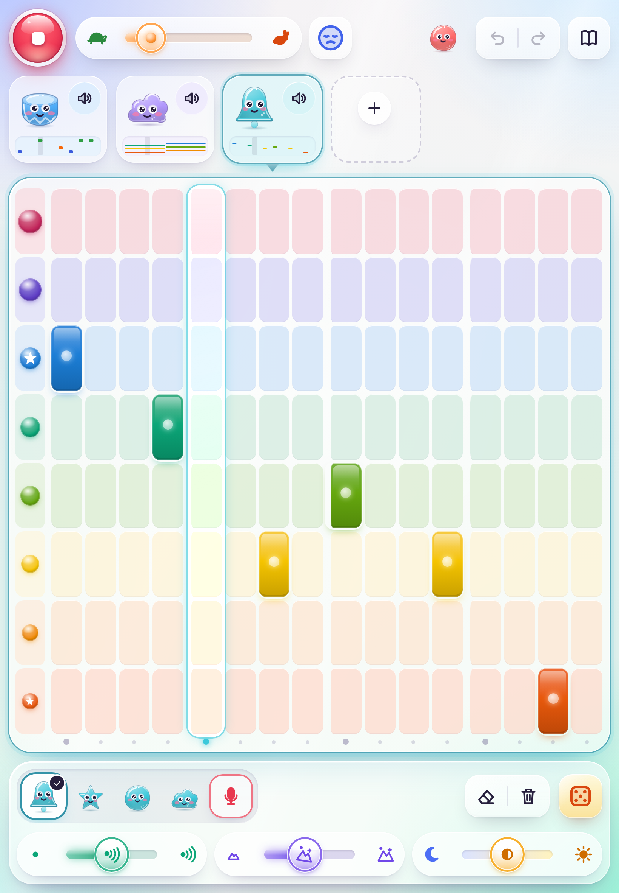
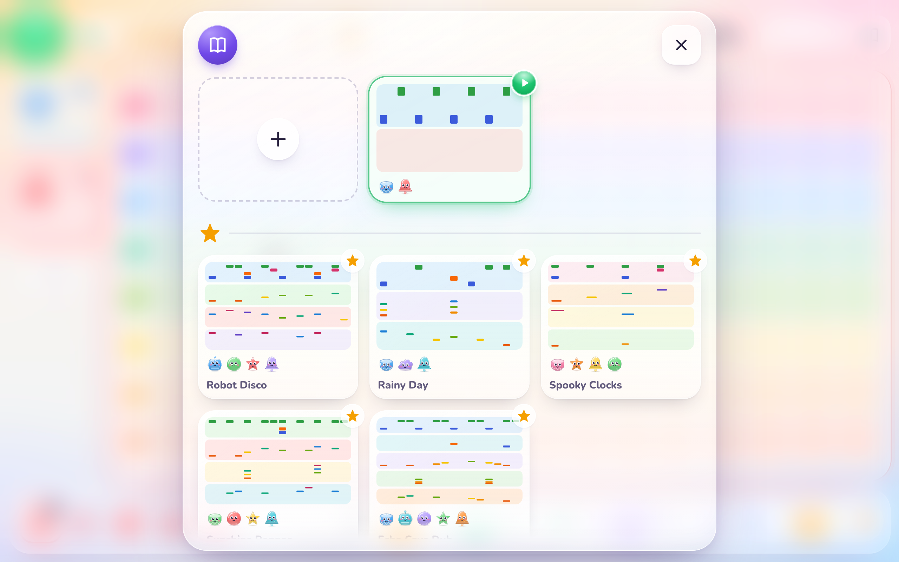
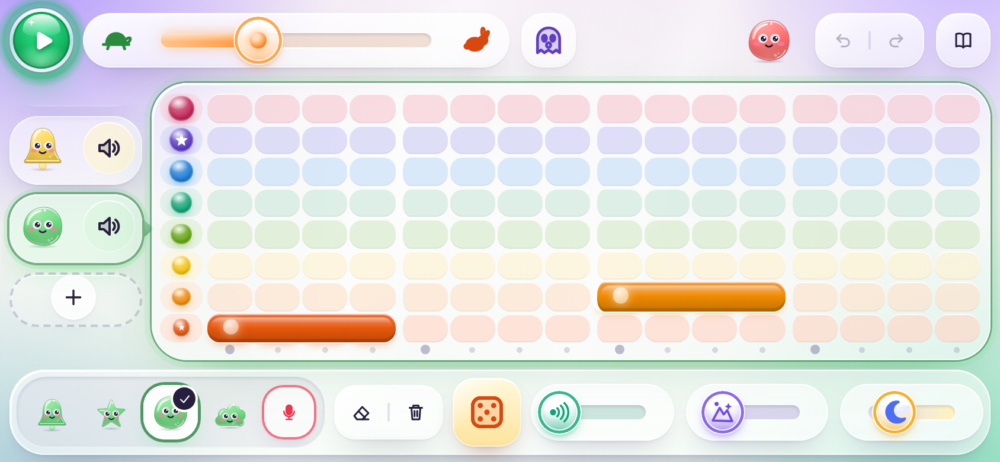

# Itchy v1: what it did and how it looked

The first version of Itchy was finished in November 2026, with hand-written Web Audio and no build step. This page
records what it did and how it looked, as the target the current app works towards.

- **Play it:** <https://hcaw.github.io/itchy/>. It stays frozen at v1.
- **Read it:** the git tag `v1`. Its browser test, `tests/e2e/check.mjs` at that tag, checks most of the behaviour below.

It is a starting point, not a contract. The design system and new ways of playing will change things on purpose;
when the app deliberately differs from v1, record why in [`../DECISIONS.md`](../DECISIONS.md). When a slice brings a
feature back, tick it here and cover it in `tests/e2e/`.

## How it looked

| Laptop                                                                                                                                                                                                                                                                                                                                         | Tablet, upright                                                                                                                                                                                  |
| ---------------------------------------------------------------------------------------------------------------------------------------------------------------------------------------------------------------------------------------------------------------------------------------------------------------------------------------------- | ------------------------------------------------------------------------------------------------------------------------------------------------------------------------------------------------ |
|  |  |

| The songbook                                                                                                                                                                                                              | Phone on its side                                                                                                                                      |
| ------------------------------------------------------------------------------------------------------------------------------------------------------------------------------------------------------------------------- | ------------------------------------------------------------------------------------------------------------------------------------------------------ |
|  |  |

The screen: a top bar (Play, tempo, mood, the Itchy critter, undo and redo, songbook), the critters down the side
(along the top on an upright tablet), the selected critter's grid in the middle, and a dock below (sounds, rub out,
remove, dice, charms). Every surface is translucent glass over a soft glow in the mood's colours, the critters are
glossy jelly sweets, and Play is a glass orb. The visual language and its decisions are in
[`../DECISIONS.md`](../DECISIONS.md).

## What it did

Each feature names the [roadmap](../ROADMAP.md) slice that brings it back. ✓ means the current app has it.

### Playing

|     | Feature             | How v1 behaved                                                                                                                         | Slice                               |
| --- | ------------------- | -------------------------------------------------------------------------------------------------------------------------------------- | ----------------------------------- |
| ✓   | Play and stop       | One big glass orb, emerald to play and red to stop, its triangle morphing into a square; Space too. The loop goes round until stopped. | Skeleton (button only; Space later) |
| ✓   | Playhead            | A bar of light over the column being heard.                                                                                            | Skeleton                            |
|     | Beat ruler and gaps | Dots under the grid, lit with the playhead, and a wider gap every four steps.                                                          | Full look                           |
|     | Tempo               | A turtle ↔ rabbit slider, 60 to 160 BPM, 100 to start. Changes are smooth mid-play; a tick sounds at the new speed.                    | Sleep, tempo, swing                 |
|     | Swing               | In the data and the engine; no control on screen.                                                                                      | Sleep, tempo, swing                 |

### The grid

|     | Feature        | How v1 behaved                                                                   | Slice            |
| --- | -------------- | -------------------------------------------------------------------------------- | ---------------- |
| ✓   | Tap a note     | It sounds at once and joins the loop; tap again to rub it out.                   | Skeleton         |
|     | Paint a stroke | Drag across cells to paint every cell passed; the whole stroke is one undo step. | Several critters |
| ✓   | 16 steps       | Sixteenth notes.                                                                 | Skeleton         |
| ✓   | Tune rows      | 8 rows of the current mood's scale, the key's row marked.                        | Skeleton         |
|     | Drum rows      | 4 rows (kick, snare, clap, hi-hat), pad-shaped, each with an icon label.         | Sounds           |
|     | Row labels     | Tapping a row's label plays that row's sound.                                    | Sounds           |
|     | Long notes     | Drawn as bars; made by the dice and the examples, not by hand yet.               | Dice and delight |
|     | Big targets    | Every cell at least 44 px, and the gap between cells counts as part of the cell. | Full look        |

### Critters

|     | Feature                             | How v1 behaved                                                                                                                                                 | Slice               |
| --- | ----------------------------------- | -------------------------------------------------------------------------------------------------------------------------------------------------------------- | ------------------- |
|     | Several critters                    | Up to 6, each a coloured creature with its own sound, shown as cards with mini-maps of their notes.                                                            | Several critters    |
|     | Choose a critter                    | Tap its card to edit its grid; keys 1 to 6 too.                                                                                                                | Several critters    |
|     | Add a critter                       | **+** offers drums, bells, pluck, bass, cloud or the mic; the new critter plays its first note.                                                                | Several critters    |
|     | Remove a critter, rub out all notes | Two tool buttons in the dock.                                                                                                                                  | Several critters    |
|     | Sleep (mute)                        | A speaker button on the card; the critter closes its eyes, breathes out Zs, and its grid gets a dashed frame and a sleep badge. Tapping its grid still sounds. | Sleep, tempo, swing |

### Sounds and charms

|     | Feature        | How v1 behaved                                                                                                                                  | Slice  |
| --- | -------------- | ----------------------------------------------------------------------------------------------------------------------------------------------- | ------ |
|     | Sounds         | Boom drums, tiny drums, bells, pluck, bass, cloud, all synthesised. A tray under the grid; a finger previews on touch-down and chooses on lift. | Sounds |
|     | Echo           | One big handle; per-critter send to a shared echo.                                                                                              | Charms |
|     | Space (reverb) | One big handle; per-critter send to a shared reverb.                                                                                            | Charms |
|     | Dark ↔ Bright  | One handle with a neutral middle (moon ↔ sun), like a DJ filter.                                                                                | Charms |

### Moods and the dice

|     | Feature | How v1 behaved                                                                                                                                                                     | Slice            |
| --- | ------- | ---------------------------------------------------------------------------------------------------------------------------------------------------------------------------------- | ---------------- |
|     | Moods   | A face button cycles six scales: Happy, Gentle, Sunny, Cool, Mystery, Spooky. Every tune critter follows; an arpeggio plays in the new mood; the room takes on the mood's colours. | Moods            |
|     | Dice    | Invents a pattern for the selected critter, plays its first bar, and lands on a new face.                                                                                          | Dice and delight |

### Recording

|     | Feature             | How v1 behaved                                                                                                                                                      | Slice         |
| --- | ------------------- | ------------------------------------------------------------------------------------------------------------------------------------------------------------------- | ------------- |
|     | Record a sound      | The red mic in the tray or in **+**. Asks for permission only then; a kind message if refused. Up to 4 s, trimmed and normalised; the music pauses while recording. | Mic recording |
|     | Play it on the grid | A recording is a tune sound: row 4 plays it at its own pitch, rows above higher, rows below lower.                                                                  | Mic recording |
|     | My sounds           | Recordings are shared by every song; the newest four show in the tray. They survive a reload.                                                                       | Mic recording |

### Undo, saving and the songbook

|     | Feature       | How v1 behaved                                                                                                                                                                                                          | Slice                            |
| --- | ------------- | ----------------------------------------------------------------------------------------------------------------------------------------------------------------------------------------------------------------------- | -------------------------------- |
| ✓   | Undo and redo | Every change, with a whoosh; a drag is one step; Ctrl/⌘+Z and Ctrl/⌘+Y.                                                                                                                                                 | Skeleton (no whoosh or keys yet) |
|     | Saving        | Automatic; work survives a reload.                                                                                                                                                                                      | Saving                           |
|     | Songbook      | Every song you've made, plus five examples: Robot Disco, Rainy Day, Spooky Clocks, Sunshine Reggae, Echo Cave Dub. Each card shows the song's critters. Opening one never overwrites the current song. No deleting yet. | Saving                           |

### Delight and access

|     | Feature           | How v1 behaved                                                                                                                                      | Slice                    |
| --- | ----------------- | --------------------------------------------------------------------------------------------------------------------------------------------------- | ------------------------ |
|     | The Itchy critter | In the top bar; tapping it sings three notes in the mood and changes colour.                                                                        | Dice and delight         |
|     | Lively critters   | They blink and follow the pointer with their eyes; new notes give off sparks. All off when the device asks for reduced motion.                      | Dice and delight         |
|     | Keyboard          | The first Tab goes to Play; arrow keys move around the grid and Enter places a note; charms move with arrow keys; every control has a spoken label. | Full look                |
|     | Layouts           | Laptops, tablets either way up, and phones on their side (a compact one-row dock).                                                                  | Full look                |
|     | Home screen       | A web app manifest and icons, so it opens like an app on a tablet.                                                                                  | Skeleton (manifest only) |
